# Worldlines

Every GitHub profile draws the same grid of green squares. Worldlines draws your contribution year as a physicist would sketch a particle's path instead: one continuous glowing trace through a faint spacetime grid. It spikes on days with commits, and your busiest days are marked as event nodes.

<picture>
  <source media="(prefers-color-scheme: dark)" srcset="assets/demo-dark.svg">
  
</picture>

It's one SVG with CSS animation, in a dark and a light version, so GitHub shows it like any other image. It needs no service, no token beyond the workflow's own, and no dependencies past Python 3.

## Use it on your profile

Add `.github/workflows/worldlines.yml` to your profile repo (the one named after your username):

```yaml
name: worldlines
on:
  schedule:
    - cron: "0 6 * * *"
  workflow_dispatch:
permissions:
  contents: write
jobs:
  draw:
    runs-on: ubuntu-latest
    steps:
      - uses: actions/checkout@v4
      - uses: jonboy648/worldlines@v1
      - run: |
          git config user.name "github-actions[bot]"
          git config user.email "41898282+github-actions[bot]@users.noreply.github.com"
          git add assets
          git diff --cached --quiet || { git commit -m "Redraw the worldline"; git push; }
```

Then put this in your README:

```html
<picture>
  <source media="(prefers-color-scheme: dark)" srcset="assets/worldline-dark.svg">
  
</picture>
```

Run the workflow once from the Actions tab to draw today's line.

| Input | Default | What it does |
|---|---|---|
| `username` | the repo owner | Whose contributions to draw |
| `output_dir` | `assets` | Where the two SVGs are written |
| `token` | the workflow's token | Used for the GraphQL calendar query |

**Private work:** if you turn on "Include private contributions on my profile" in your GitHub settings, those days count too. Only the counts show; no repo names or details ever appear.

## Run it locally

```bash
gh api graphql -f query='query{user(login:"YOUR-NAME"){contributionsCollection{contributionCalendar{totalContributions weeks{contributionDays{date contributionCount}}}}}}' > calendar.json
python3 worldline.py calendar.json out
python3 worldline.py          # self-check
```

Also by the same author: [printed-contributions](https://github.com/jonboy648/printed-contributions), your year drawn as a 3D print.

## License

MIT
